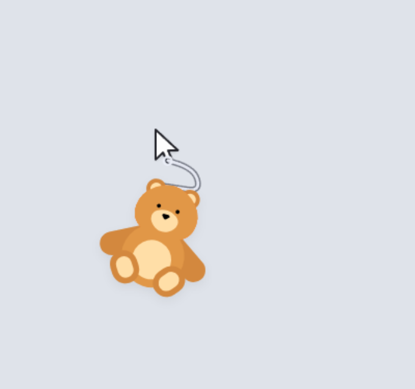

# 晴天娃娃 · 桌面挂件




一个挂在鼠标指针下方、会跟随指针移动而晃动的晴天娃娃。基于 Electron 实现，
窗口完全透明、置顶、鼠标穿透 —— 它只会"挂"在指针下面，不会挡住你的任何操作。

> [!IMPORTANT]
> **本项目由 AI（大语言模型）辅助完成。** 全部代码、文档与调试过程都在 AI 编程助手的
> 参与下产出，人类负责需求定义、验收与最终判断。这意味着：代码风格与注释密度不统一、
> 部分设计取舍是「试出来的」而非严格推导、边界情况的覆盖并不完备。请以「可以跑、
> 有测试」而非「生产级」的标准看待它。
>
> **物理模拟存在已知问题。** 绳体是 Verlet 质点链 + 位置约束的近似模型，不是刚体动力学
> 求解器。已确认的局限包括：
>
> - **大幅摆动的振幅衰减是数值耗散的产物**，不是真实阻尼：衰减系数随步长变化
>   （`b ≈ k/2 + ω²h/2`），所以「自由摆动的衰减时间」不能当作物理正确性的指标；
> - **周期只在中小振幅下接近解析解**（实测误差 ≤1.8%），大摆幅下与真实单摆差异明显；
> - **弦角穿越 ±180° 的视觉处理是工程妥协**：展开滤波 + 静止归位，极端绕圈操作下
>   仍可能出现不自然的角度跳变（详见 [`docs/04`](docs/04-已知缺陷与待修.md) 的 D/F 清单）；
> - **碰撞、自碰撞、扭转（torsion）都没有模拟**，绳子的「软」是靠弯曲角约束近似的；
> - **手感参数是调出来的，不是标定出来的**：7 档预设与 12 个滑块给的是「看起来合理」的
>   组合，没有做过主观实验或与真实摆的定量对照。
>
> 如果你要的是物理精确的绳索模拟，应该去看 XPBD / PBD 的正式实现（如 NVIDIA FleX、
> Bullet 的 soft body）。这个项目要做的是「桌面上挂个会晃的小玩意」。

**亮点**

- 🪢 **Verlet 绳链物理**：三段落软绳（4 质点）+ 弯曲约束，加速度与帧率解耦（fixedStep 1/240），
  中小振幅下周期与解析解误差 ≤1.8%（局限见上方声明）
- 🎨 **照片级可换挂饰**：面板里导入任意 JPG/PNG，命名后入挂饰库，随时下拉切换
- 🎛️ **7 档手感预设 + 12 项可调参数**：`Ctrl+Alt+S` 开面板，拖滑块即时生效、自动记住
- 🧪 **可验证的物理**：`node rope.test.cjs` 17 组回归 + `node verify.cjs` 9 组验收量化指标（测的是「有没有变差」，不是「对不对」）
- 📝 **10 份中文设计文档**：物理推导、参数手册、缺陷清单、测试方法论、决策日志全都在 `docs/`

没有素材图时用 emoji 🧸 占位，换成自己的图片见下文「换图片」。
> 📚 **开发/维护文档在 [`docs/`](docs/00-索引.md)**：需求清单、系统架构、参数调校、
> 已知缺陷、测试方法论、路线图。改代码或排查问题前请先看那一份。

> **调手感不用改代码**：按 `Ctrl+Alt+S`（或托盘右键 →「设置…」）打开设置面板，
> 拖滑块即时生效、自动记住，下次开机还在。

> 四个必读条目：
> - [`docs/09-物理评审与重构方案.md`](docs/09-物理评审与重构方案.md) —— **第 3 轮物理重构的完整推导**，为什么删掉三道几何投影、闭式解怎么来的
> - [`docs/04-已知缺陷与待修.md`](docs/04-已知缺陷与待修.md) —— 当前还差什么（只剩系统指针未隐藏 D1）
> - [`docs/03-测试方法论.md`](docs/03-测试方法论.md) —— 测试时如何避免真实鼠标干扰
> - [`docs/05-参数调校手册.md`](docs/05-参数调校手册.md) —— 想改手感先读这个

> ⚠️ [`docs/08-绕圈物理说明.md`](docs/08-绕圈物理说明.md) 是**历史存档**：
> 它描述的 `_centripetal` 绕圈检测已在第 3 轮整体删除，里面的参数表全部失效。

---

## 快速开始

双击 **`启动晴天娃娃.bat`** 即可。

或者在本目录的命令行里：

```
npm start
```

> 首次运行前需已经 `npm install`（本目录的 `node_modules` 已就绪，可直接启动）。

---

## 操作

| 操作 | 说明 |
| --- | --- |
| 移动鼠标 | 娃娃挂在指针下方，被拖着走，会自然地晃 |
| 快速甩动 | 娃娃甩得更厉害（渲染层有 tanh 软限幅，不会倒挂；嫌甩太狠就在面板里调小「最大倾斜角」） |
| 静止不动 | 3~4 秒内自然回正（`tau ≈ 3.2~3.4s`；嫌停不下来就把面板里的「晃动持续」往上调） |
| **`Ctrl+Alt+S` / 托盘「设置…」** | **打开设置面板**：三个标签页（图片/挂点与绳索/物理），7 个档位 + 12 个手感参数 + 挂饰导入 |
| 面板底部「开始记录」/ 托盘「开始诊断记录」 | **每 0.1s 记一条当前状态**（质点坐标、速度、加速度、绳子合力），存到 `%APPDATA%\sunny-doll\records\`；手感不对时用它把现场存下来 |
| 托盘图标右键 | 菜单：显示/隐藏、设置、重载配置、退出 |
| `Ctrl+Alt+Q` | 直接退出（全局快捷键，游戏里也能用） |
| `Ctrl+Alt+H` | 显示/隐藏娃娃 |

鼠标穿透是默认开启的：娃娃**永远不响应点击**，点击会穿透到它下面的窗口。

---

## 换图片（挂饰）

**推荐：设置面板 →「图片」页**（`Ctrl+Alt+S`）：


1. 点「导入图片…」选一张本地 JPG/PNG（建议透明背景、正方形、边长 ≥ 256px）。
   图片会**复制进项目** `assets\dangles\` 目录，之后移动或删除原图都不影响使用；
2. 输入挂饰名称，点「保存到挂饰库」——它会出现在上方「挂饰」下拉里；
3. 之后随时通过「挂饰」下拉切换：自带小熊 🧸 和所有保存过的挂饰都在里面，
   下方的当前挂饰（名称 + 缩略图）会跟着联动。
「娃娃大小」也在这一页（同一个下拉框下面），拖滑块即时生效。


也可以改 `renderer/config.js`：`doll.dangle` 设为 `"image"` 且 `doll.image.path`
填上图片路径；图片加载失败会自动回退到 emoji。挂饰库存放在 `doll.dangleList`
（JSON 数组字符串 `[{name,path},...]`）、当前名称在 `doll.dangleName`。
> 娃娃的**顶部**贴在绳端，所以图片上方透明留白越少，绳子看起来越连贯。

---

## 调手感

### 推荐：用设置面板（不用改代码）

按 **`Ctrl+Alt+S`**，或者托盘图标右键 →「**设置…**」。

- 拖滑块**即时生效**，不用重启；改动会自动记住，下次开机还在。
- 存在 `%APPDATA%\sunny-doll\settings.json`，**不改动项目里的 `config.js`**。
- 顶部是 **7 个档位**，从「最缓最轻」到「最快最猛」：

  | 档位 | 感觉 | gravity | dampingPerSecond | drag | angleLimit | 一个来回 |
  | --- | --- | --- | --- | --- | --- | --- |
  | **1** | 最缓最轻 | 1400 | 0.45 | 0.00026 | 17 | 1.18 秒 |
  | **2** | 更缓 | 1700 | 0.40 | 0.00024 | 24 | 1.07 秒 |
  | **3** | 偏缓 | 2100 | 0.37 | 0.00021 | 32 | 0.96 秒 |
  | **4** | 出厂默认 | 3300 | 0.30 | 0.00015 | 45 | 0.77 秒 |
  | **5** | 偏快 | 3800 | 0.26 | 0.00014 | 52 | 0.72 秒 |
  | **6** | 更快 | 4200 | 0.23 | 0.00012 | 58 | 0.68 秒 |
  | **7** | 最快最猛 | 4800 | 0.20 | 0.00010 | 64 | 0.64 秒 |

- **选档位只预览，点「应用」才真的生效**。这样你可以来回点几个档位比手感，
  不会每点一下就改一次物理。选中未应用的档位是**描边高亮**，已生效的是**实心蓝**。
- 滑块则相反：**拖一下立刻生效**（调手感必须一边拖一边看）。手动拖过之后档位高亮自动取消。
- 底部「恢复出厂默认」= 清空那个 json，回到 `config.js` 里的值。
- 托盘右键也有「档位」子菜单，可以直接换档，不用开面板。

**能调的有 12 项**：摆动快慢（`gravity`）、晃动持续（`dampingPerSecond`）、
空气阻力（`drag`）、呼吸感（`turbulence`）、最大倾斜角（`angleLimit`，**5~180°，180 = 不限制**）、
旋转跟手（`bodyAngleTau`）、娃娃大小（`heightRatio`）、
**挂点左右（`attachOffsetX`）、挂点上下（`attachOffsetY`）**、软硬段数（`segments`）、
绳长（`lengthRatio`）、绳子粗细（`width`）。

**故意不给你碰的**：`fixedStep` / `maxStepsPerFrame` / `maxAccumulator` /
`maxBend` / `bendIterations` —— 这些是数值安全阀，调坏了只会更难用甚至崩掉。

### 改出厂默认：编辑 `renderer/config.js`

如果你希望**新装的人也拿到你调好的值**，那才需要改这个文件
（改完在托盘里点「重载配置」即可生效，不用重启）。

> 注意两者的关系：`settings.json` 里有的字段**覆盖** `config.js`，
> 没有的字段用 `config.js`。所以你在面板里调过的项，改 config.js 是看不出来的
> —— 想让用户重新拿到新默认值，得在面板里点「恢复出厂默认」。

> 下面只列**当前真实生效**的参数。旧文档里出现过的 `velocityDamping`、
> `maxAngle`、`angleSpring`、`angleGuard`、`monoDrop`、`minDroopRatio`、
> `centripetal*`、`cursorSmoothing`、`cursor.bodyHeightRatio` **都已从代码中删除**，
> 改了不会有任何效果。

### 绳子外观 `rope`

| 参数 | 默认 | 含义 |
| --- | --- | --- |
| `lengthRatio` | 0.07 | 绳长 = 屏幕高度 × 该值，再夹在 `min`~`max` 之间 |
| `min` / `max` | 60 / 120 | 绳长的下限/上限（像素） |
| `width` | 2.2 | 绳子粗细 |
| `color` | 浅灰白 | 绳子颜色（`rgba` 支持透明度） |
| `overlap` | 10 | 绳子末端再往下多画几像素，伸进娃娃身体里，避免"断在半空" |
| `outline` | 开 | 绳子描边，白底和深色桌面上都看得见 |
| `loop` / `loopRadius` | 开 / 3 | 指针挂点处的小圆环 |

### 绳索物理 `chain`

| 参数 | 默认 | 含义 |
| --- | --- | --- |
| `segments` | **3** | 段数（**质点个数 = segments + 1**，别搞混）。3 段 = 4 质点 = 2 个可弯关节，是**能弯出明显弧度的最小配置**。上限是 4：5 段以上长度会漂（实测 60s 剧烈甩动，4 段漂到 63.05px、5 段漂到 67.72px） |
| `iterations` | **2** | 每子步约束迭代次数。`stiffness = 1` 时 1 次就够（实测 1/2/4/8/16 结果完全一致） |
| `stiffness` | 1.0 | 只在 `elasticity: true` 时生效；`false` 时强制按 1 处理 |
| `elasticity` | false | `false` = 绳长绝对不变 |
| `maxStretch` | 1.35 | 单节最多能拉长到标准长度的几倍（`elasticity: false` 时实际不生效） |
| `tailMass` | 1.6 | 末端质点质量倍数。**实测对摆动几乎无效**（0.3/1/1.6/5/20 的 tau 全是 4.05s） |
| **`dampingPerSecond`** | **0.30** | 阻尼率 k，单位 **1/s**。作用在速度上，振幅衰减速率是 k/2；再叠加 PBD 固有耗散 ω²h/2 ⇒ 实测 tau ≈ 4s |

### 物理 `physics`

| 参数 | 默认 | 含义 |
| --- | --- | --- |
| `gravity` | **3300** | 重力加速度。周期由**链式刚体摆**决定（质量沿绳分布，不是 `2π√(L/g)` 那个点质量公式）：3 段绳在 L=60.5 时 3300 → 实测 0.777s。旧值 8000 只有 0.50s，像在抽搐 |
| `drag` | 0.00015 | 空气阻力（与速度平方成正比），**只负责限制高速摆动**，不负责衰减时长 |
| `maxBend` | **1.50** | 单个关节的最大弯曲角（弧度，≈86°）。只限关节角、**不限绝对朝向**，所以绳子仍能整体翻到挂点上方 |
| `bendIterations` | **10** | 弯曲上限与长度约束的交替迭代轮数。关节越多越难收敛：3 轮时 4 段绳最差关节只压到 69.2°（不合格），10 轮才 93.6° |
| `turbulence` | **60** | 湍流强度，静止时也有轻微飘动的"呼吸感"，0 = 关闭。g=3300 下 60 ≈ 1.4° 等效倾角（旧值 12 在 g=8000 下只有 0.23°，肉眼完全看不见） |
| `followMode` | `"velocity"` | 挂点跟随策略。`"velocity"` = 按真实鼠标速度推进（才有离心力）；`"translate"` = 整链刚性平移 |
| `maxPivotStep` | 400 | 单帧位移超过这个值的 4 倍视为"瞬移"（如切屏），直接吸附、不产生冲量 |
| `fixedStep` | 1/240 | 物理固定步长，保证各种刷新率手感一致 |
| `maxStepsPerFrame` / `maxAccumulator` | 48 / 0.1 | 每帧最大子步数 / 累加器上限（秒） |

### 娃娃渲染 `doll` 里与手感相关的三项

| 参数 | 默认 | 含义 |
| --- | --- | --- |
| `angleDeadzone` | **0.02** | 旋转死区（弧度，≈1.1°）。旧值 0.10（5.7°）会把停手后 60~74% 的帧角度直接归零 |
| `bodyAngleTau` | **0.08** | 旋转角低通时间常数（秒）。调大更顺但跟不住大摆幅 |
| `angleLimit` / `angleLimitOvershoot` | **45 / 18** | tanh 软限幅：45° 以内线性，以上渐近压到 **63°**。**只作用在画出来的角度上，不写回物理**。面板可调 **5~180°**，其中 **180° = 完全不限幅**（熊可以倒挂，见 R20） |

### 指针挂点 `cursor`

**程序不再画鼠标指针**，直接用 Windows 的系统指针。这一节只剩两个字段。

| 参数 | 默认 | 含义 |
| --- | --- | --- |
| `attachOffsetX` | **7** | 挂点相对系统指针热点（箭头尖）的横向偏移，CSS px |
| `attachOffsetY` | **19** | 挂点相对热点的纵向偏移，CSS px |

默认 `(7, 19)` 对应 100% 缩放下的 Windows 标准箭头（图形约 12.3 × 18.6，热点在左上角），
绳子正好从箭头尖下方垂下来。

**觉得绳子离箭头太近/太远/偏左偏右**：打开设置面板（`Ctrl+Alt+S`）→「指针」组，
调「挂点左右 / 挂点上下」两个滑块（`-40 ~ +90`）。换了指针主题、改了 DPI 缩放、
开了辅助功能的「指针大小」，都要在这里重新调一次 —— 程序**读不到**系统指针的图形尺寸。

**调参建议**

- 觉得**晃得太小、看不出来**：先调大 `doll.angleLimit`（当前 45，可见封顶 63°；调到 180 就完全不限幅）。这是渲染层限幅，不动物理。
- 觉得**晃得不够久**：`chain.dampingPerSecond` 往下调（当前 0.30）。注意它同时决定"匀速拖动时的偏角"——同一个 k。
- 觉得**摆得太快、像抽搐**：`physics.gravity` 往下调（当前 3300）。周期约 `∝ 1/√g`。
- 觉得**高速时绳子被拖成水平**：`physics.drag` 往上调（当前 0.00015）。
- 觉得**绳子折叠/打结**：`physics.maxBend` 往下调（当前 1.50）。调小会让"杆感"变强。
- 想**绳子更有弹性**：`chain.elasticity` 改 `true` + `chain.stiffness` 0.6~0.85 + `maxStretch` 1.5。实测拉伸量只有 0.1~0.4%，"弹"感主要来自阻尼而非拉伸。
- 想**绳子更长更仙**：`rope.lengthRatio` 调到 0.09（或直接调 `rope.max`）。
- 觉得**跟不上鼠标**：不需要调，挂点已经零延迟跟随指针。
- 觉得**娃娃太大/太小**：`doll.heightRatio`（0.10）、`doll.heightMin`/`heightMax`（56/128）。

---

## 项目结构

```
v0/
├── main.js             主进程：透明置顶窗口、全局快捷键、托盘、鼠标穿透
├── preload.js          预加载：安全地向渲染层暴露 IPC 通道（覆盖层用）
├── settings-preload.js 预加载：设置面板的 IPC 桥
├── settings-schema.js  设置面板能调什么（字段范围、步长、7 档位、钳制）
├── settings-store.js   用户设置持久化（%APPDATA%/sunny-doll/settings.json）
├── package.json
├── settings/
│   ├── settings.html   设置面板界面
│   ├── settings.css    深色主题
│   └── settings.js     面板逻辑 + 派生读数（周期 / tau / 实际像素）
├── rope.test.cjs       绳索物理回归测试（纯 Node，17 组，不需要 Electron）
├── verify.cjs          验收测量脚本（读真实 config 默认值，测 8 组固定指标）
├── 启动晴天娃娃.bat      双击启动
└── renderer/
    ├── index.html      页面骨架
    ├── style.css       透明背景、pointer-events: none、cursor: none
    ├── config.js       所有可调参数（就改这个文件）
    ├── rope.js         绳索物理：RopeChain 类（Verlet + PBD + 弯曲约束）
    ├── recorder.js     诊断记录器：Recorder 类（每 0.1s 采样，只读物理）
    ├── doll.js         绘制：绳子、吊环、emoji/图片（指针是系统的，不画）
    └── main.js         渲染循环、挂点计算、响应窗口尺寸变化
```

### 物理原理

绳子被建模成 **3 段 4 质点的链**（`segments: 3`），相邻质点用距离约束连起来，整体从指针下边缘垂下去。

> 注意 `segments` 是**段数**，`rope.rebuild(len, count)` 的第二个参数是**质点个数** = 段数 + 1。
> 早期把 2 直接传给 rebuild，得到的是「2 个质点 = 1 段」，数学上永远是直线 —— 这就是"绳子变成钢棍"的根因。
>
> 为什么是 3 段：1 段必然直线（无关节可弯）；2 段只有 1 个关节，弯出的弧很僵；
> 3 段 = 2 个可弯关节，中间节点最多偏离首尾连线 **20.1px（占绳长 33%）**，是真弧线；
> 4 段以上长度会漂（60s 剧烈甩动实测：4 段 60.19~63.05px、5 段 59.79~67.72px，正常应恒为 60.5px）。
> 折叠问题已由 `_limitBend` 解决，不再是选型的约束（实测所有拓扑 folds 都是 0）。

**1. Verlet 积分**（不显式存速度，用"当前位置 - 上一帧位置"表示速度）：

```
x_next = x + (x - x_prev) * keep + a * h²
keep = exp(-k * h)          // k = chain.dampingPerSecond，单位 1/s
```

- `keep` 必须是 `exp(-k*h)`。旧实现是每子步 `keep = 1 - velocityDamping`，
  导致"1 秒后速度留存率"60Hz 0.697 / 480Hz 0.056（差 1252%），改 `fixedStep` 等于换引擎。
- 好处：二阶精度、天生稳定、位置式积分在约束下不会爆炸。

**2. 距离约束（PBD）**：每步把每对相邻质点推开/拉近到标准绳长，按逆质量加权各退一半，重复 `iterations` 次。

```
e = |p_j - p_i| - restLen
p_i -= w_i / (w_i + w_j) * e * stiffness * dir
p_j += w_j / (w_i + w_j) * e * stiffness * dir
```

- `stiffness < 1` 就是"有弹性"——绳子会被拉长一点再回弹
- **PBD 投影本身有数值耗散**，且 `b_num ≈ 47·h`、`b_num ∝ 1/L ∝ ω²`。
  所以"自由摆衰减多快"永远随 `fixedStep` 漂移，这是算法特性、不是 bug。

**3. 弯曲约束（`_limitBend`）**：限制单个关节的最大弯曲角（`maxBend: 1.50` 弧度 ≈ 86°）。
做法是**绕关节纯旋转**（同时转 `x/y` 与 `px/py`），精确保段长，不会注入拉伸。
它只限"单关节弯多少"，**不限绝对朝向**，所以绳子能整体翻到挂点上方。

必须与长度约束**交替迭代**（`bendIterations: 10`）：掰直 j 号关节会把 j±1 号掰弯，
单轮实测最差关节 77.9°、总长冲到 107px。收尾那一次必须是 `_limitBend` 而不是 `_solveConstraints`，
否则刚压下去的角度会被拉回来一部分。

**4. 外力**：重力 + 与速度平方成正比的空气阻力 + 双正弦叠加的湍流（静止时也有轻微飘动的呼吸感）。

**关键参数与踩过的坑**：

| 参数 | 值 | 为什么是这个值 |
|------|-----|--------------|
| `gravity` | 3300 | 周期由链式刚体摆决定（质量沿绳分布），3 段绳 L=60.5 时实测 0.777s。旧值 8000 只有 0.50s，像在抽搐 |
| `dampingPerSecond` | 0.30 | 单位 1/s。振幅衰减速率是 k/2，再叠加 PBD 固有耗散 ω²h/2 ⇒ 实测 tau ≈ 4s |
| `drag` | 0.00015 | 二次阻力，只负责限制高速摆幅，不负责衰减时长 |
| `maxBend` | 1.50 | 单关节上限 86°。这是当年 `monoDrop`/`minDroopRatio` 的正确替代品 |
| `bendIterations` | 10 | 弯曲约束与长度约束交替迭代轮数。关节越多收敛越慢 |

**历史教训（都已删除）**：

| 已删参数 | 当时的做法 | 为什么删 |
|---|---|---|
| `monoDrop` | 每个节点必须比上一个低 1px（几何投影） | 语义上直接禁止绳子翻到上方，与 R15 冲突 |
| `minDroopRatio` | `tip.y - anchor.y >= L * ratio` | 绳长恒定 ⇒ **最大摆角 = acos(ratio)**，0.9 就是 25.8°，这是 R13 的数学根因 |
| `_centripetal` 整套 | 加速度方向变化率检测绕圈、旁路上面三道投影 | 绕圈时那些投影本来就被旁路，开/关数值完全相同 ⇒ 无效复杂度 |
| `_lastH` / `ratio` | 想按步长变化校正速度 | `_lastH` 从未被更新 ⇒ ratio ≡ h×240，1/60 速度每步 ×4 直接爆炸 |

- 积分用**固定步长** `1/240` 秒 + 累加器，因此各刷新率下手感一致（实测 spread 0.08°）。
- **挂点零延迟**，且把本帧位移**均摊到 willRun 个子步**推进（`followMode: "velocity"`），
  这样 Verlet 速度 = 真实鼠标速度，离心力才生效。一次性注入第一个子步会毁掉帧率无关性
  （实测 60fps 1.44° vs 240fps -23.54°）。
- 子步数为 0 的帧**什么都不做**（连 `_prevAnchorX` 都不更新），否则 360Hz 屏每三帧丢一次位移。

### 为什么用系统指针，而不是自己画一个

早期版本用 Canvas Path2D 自己画箭头（`renderer/cursor.js`），再用 Win32 `ShowCursor(false)`
试图隐藏系统指针 —— **这条路走不通，而且不是"还没做完"，是架构上不可达**：

- `ShowCursor(bool)` 改的是**调用线程**的显示计数，只影响该线程拥有的窗口。
  覆盖层是鼠标穿透（`setIgnoreMouseEvents(true,{forward:true})`）+ `focusable:false` 的窗口，
  **从不持有鼠标、从不获得焦点** —— 指针下方是**别的窗口**在处理 `WM_MOUSEMOVE`，
  显隐由那个窗口的线程决定。实测 `ShowCursor(false)` 返回 -1（本进程计数确实减了），
  但 `GetCursorInfo` 仍返回 `flags: 1`（可见）。
- 系统指针**不是窗口**，由 Windows 的 DWM 画在独立的硬件光标平面上，
  任何置顶窗口都盖不住它。所以程序画的任何东西永远在系统指针**下面**一层。
- `SetSystemCursor` 能全局换形状，但那是全系统副作用：只要右键菜单、设置面板、任务栏
  这类置顶窗口压在覆盖层上，屏幕上就会**完全没有指针** —— 而那恰恰是你要点菜单的时刻。

⇒ 第 11 轮（m03147 / m03155）改成：**删掉自绘指针和 `system-cursor.js`，
直接用系统指针**，挂点偏移写成常量 `(7, 19)`，并在设置面板里给两个滑块让你按自己的指针调。
顺带的好处：koffi 这个原生依赖没了，程序对系统指针再无任何全局副作用。

---

## 测试

```
npm test        # 回归测试，17 组，末行打印「全部通过 ✓」
npm run verify  # 验收测量，输出 8 组固定指标（改完 config 后跑，和下面 / docs 的基线对照）
```

> 设置面板有三层测试要求（存储层 / 应用后物理 / 真实 IPC），见
> [`docs/03-测试方法论.md`](docs/03-测试方法论.md) 第三之二节。

回归测试共 **17 组**场景：

| # | 场景 | 当前实测 |
|---|---|---|
| 1 | 静止竖直下垂 | `total=90.0` |
| 2 | 段数 1~4 均可构建（`count = segments + 1`） | 2/3/4/5 全过 |
| 3 / 4 | 左/右甩动的摆动方向（匀速段平均角） | `±2.71°`、`avgDX=-4.22px` |
| 5 | 弯曲自由度 | 1 段 0.000 / 2 段 0.093 / 3 段 2.613 rad |
| 6 / 7 | 弹性关闭长度不变 / 拉伸比上限 | `90.001`（上限 90.18）/ `worst=1.016` |
| 8 | 瞬移不产生冲量 | `0.00°` |
| 9 | **帧率无关**（60/120/144/240fps） | `spread=0.07°` |
| 10 | 停手后基本静止（12s 窗口 + R14 慢衰减） | `maxDX=3.28`、首次收敛 11.35s |
| 11 | NaN / 超大位移健壮性 | 全过 |
| 12 | **自由摆周期** vs **链式刚体摆**理论值 | `0.982s` vs `0.977s` |
| 13 | **振幅衰减 tau** vs `1/(k/2 + ω²h/2)` | `4.13s` vs `4.42s` |
| 14 | **fixedStep 无关**（1/60~1/480） | `spread=0.18°` |
| 15 | 关节不折成锐角 + 能翻到挂点上方 | `worst=93.7°`（下限 89.1°）、`above 254/600` 帧 |
| 16 | 60s 剧烈甩动 | `len 90.00~90.61`、`bad=0` |
| 17 | 性能 | `3.47ms`（0.0058ms/帧） |

> 表里的数字随 `config.js` 改动会变，**判据**（阈值）不变。
> 测试驱动必须**平滑加速**（`rampDrive`），不能一帧给满速度 ——
> 一帧 1200px/s 等于一次冲量，能量守恒 `½v² = gL(1-cosθ)` 代入 v=1200/g=3300/L=90 直接得 θ=180°，
> 物理上就该翻过去，翻顶后是混沌轨迹，任何"帧率无关"断言都会假失败。

---

## 诊断记录（手感不对时用它）

娃娃「弹得停不下来」「飞过鼠标」「被拽住了一下」这种描述没法用来改代码。
点面板底部的 **「开始记录」**（或托盘右键 →「**开始诊断记录**」），
它会**每 0.1 秒**把当前状态存一条，包括：

- 绳子上 **4 个质点的坐标与速度**、每一节的长度；
- 绳端的 **弦角与角速度**；
- 娃娃（末节质点）的 **速度、加速度、受到的绳子合力** `ropeFx/ropeFy/ropeF`；
- 画出去的角度 vs 没限幅前的角度（`doll.clamped` = 是否被「最大倾斜角」压住了）。

再点一次「停止记录」，文件会存到
`%APPDATA%\sunny-doll\records\record-YYYYMMDD-HHMMSS.json`，
**每条样本一行**，可以直接用记事本或 `Select-String` 挑出来看。

几条设计上的取舍，读数据前值得先知道：

- **`ropeF` 是「绳子合力」，不是净值**。净值恒等于 `m·a`，没有信息量；
  绳子合力才是"绳子在拉多大的力"。**静止竖直时它精确等于 `m·g`**
  （`mass 1.6 × gravity 3300 = 5280`），这一条同时是最好的自检。
- **单位是 `px/s² × 相对质量`，不是牛顿** —— 程序里没有真实的质量/长度换算，
  绝对值只用于前后对比和量级核对（比如"峰值是不是到了 16 倍 m·g"）。
- **算不出来的量写 `null`，不写 0**。首条样本没有上一条可比，所以它的加速度和受力都是 `null`。
- **`meta.config` 是开录那一刻的完整设置快照**。中途改滑块会让曲线前后不可比，
  分析时必须看这个，而不是现在的面板值。
- 上限 **18000 条 = 30 分钟**，撞上限会自动停（`stopReason: "auto"`）。
---

## 常见问题

**娃娃不显示？**
确认它在屏幕内（娃娃会挂在指针下方，指针贴着屏幕底部时它会被裁掉一部分）。
试试按 `Ctrl+Alt+H` 看是否被隐藏了。

**托盘图标不见了？**
程序还在运行。看看任务栏右下角的折叠区，或者用任务管理器结束 `electron.exe`。

**想开机自启？**
按 `Win+R` 输入 `shell:startup`，把 `启动晴天娃娃.bat` 的快捷方式丢进去。

**设置面板打不开 / 调了没反应？**
`Ctrl+Alt+S` 是开关：没开就开，开着再按一次就关。也可以从托盘右键 →「设置…」打开。
如果滑块拖了没变化，检查这几点：
1. 面板底部有没有停在「恢复出厂默认」上（那会清空所有覆盖值）；
2. 如果某项显示「已改」但看不出效果，可能是这个参数只影响高速段
   （`angleLimit` / `drag` 都是这样，慢慢晃是看不出来的）；
3. 想看底层存了什么：`%APPDATA%\sunny-doll\settings.json`（可以直接手改，
   但主进程会按 `settings-schema.js` 的范围钳制，越界值会被拉回边界）。

**改了 config 不生效？**
如果改的是 `renderer/` 下的文件，从托盘点「重载配置」会重新加载页面。
如果改的是 `main.js`，必须退出重开。

**绳子挂的位置不对（离箭头太近 / 太远 / 偏左偏右）？**
打开设置面板（`Ctrl+Alt+S`）→「指针」组，调「挂点左右」「挂点上下」两个滑块，`-40 ~ +90` px。
默认 `(7, 19)` 是按 100% 缩放下的 Windows 标准箭头算的；换了指针主题、改了 DPI 缩放、
或开了辅助功能的「指针大小」，都得在这里重新调一次 —— 程序**读不到**系统指针的图形尺寸。

**为什么指针永远盖在绳子上面？**
因为那是 Windows 自己画的，在独立的光标平面上，任何窗口都盖不住。
程序已经不再自绘指针了（第 11 轮改的），快速甩动时绳子只会表现为**从指针背后穿过**。

**绳子被甩到水平甚至翻到指针上方？**
这是**设计如此**（需求 R15）：快速甩动时离心力确实能压过重力，绳子会整体翻上去。
物理层完全不限幅；渲染层的 `doll.angleLimit`（出厂 45°+18°，tanh 渐近到 63°）
只限制**娃娃画出来的旋转角**，不写回物理。
**注意**：如果把「最大倾斜角」调到 180（第 12 轮的「无限制」），熊就会跟着绳子一起倒过来 ——
这是你自己选的（R20），出厂值仍然是 45°，所以默认不会倒挂。
觉得翻得太厉害，调小 `physics.maxBend`（当前 1.50 弧度 ≈ 86°），但要接受"杆感"变强。

**摆动太小 / 停手后几乎不动？**
现在不该这样了。如果出现，先按顺序检查：
1. `doll.angleDeadzone` 是不是被改回 0.10 了（当前 0.02，0.10 会把停手后 60~74% 的帧角度归零）；
2. `doll.angleLimit` 是不是被改小了（出厂 45，这是渲染层的旋转上限；面板范围 5~180）；
3. `chain.dampingPerSecond` 是不是被调太大了（当前 0.30，它的两倍会让 tau 掉到 2s 以内）。
详细诊断见 `docs/04-已知缺陷与待修.md` 的 D2。
---

## 项目性质与免责

这是一个**个人兴趣项目**，由 AI 辅助编写，**不是经过工程化验证的软件**：

- 只在 Windows 10/11 上测试过，其他平台未验证；
- 物理部分是可用的近似模型，不是精确仿真（详见文首「物理模拟存在已知问题」）；
- 没有 CI、没有代码审查流程、没有版本语义化承诺，接口和参数随时可能变；
- 按 MIT 许可证「as is」提供，不对任何使用后果负责。

如果你发现 bug 或想改进，欢迎提 issue —— 但请理解作者是把它当作玩具在维护。
